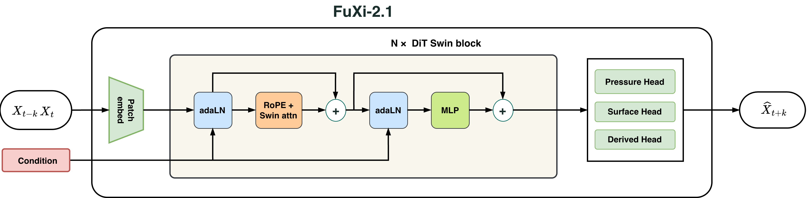

# FuXi-2.1 (project-native)

A downscaled reimplementation of the **FuXi-2.1** global weather forecasting
architecture, adapted to the project's 1.5-degree ERA5 dataset. It reproduces
the architecture so it can be trained **from scratch** on any channel layout;
the official 0.25-degree / 85-channel weights are **not** loaded.

> Reference: https://huggingface.co/tpys/fuxi-2.1 (Fudan University & SAIS).

## Architecture



FuXi-2.1 replaces FuXi-1.0's U-Transformer with a **flat single-trunk
Transformer** (no U-Net down/up-sampling):

```
patch/const embed → Swin window attention (1-D RoPE) + adaLN(step/hour/doy) + SwiGLU FFN
                 → variable-aware multi-head decoder (pressure / surface / derived)
```

| Component | This implementation |
|---|---|
| Backbone | flat Swin trunk (`FuxiSwinBlock` × `depth`) |
| Position encoding | 1-D RoPE inside windowed attention (`FuxiWindowAttention`) |
| Conditioning | adaLN on lead step / time-of-day / day-of-year (`FuxiTimeEmbed`) |
| FFN | SwiGLU (`SwiGLUFFN`, ratio `8/3`) |
| Decoder | `FuxiVarHead`: pressure-level deconv head + surface/derived pixel-shuffle heads |

The module layout mirrors the released `.pt2` state_dict (`decoder.patch_embed`,
`decoder.layers.N.{norm1,attn,norm2,mlp,adaln}`, `decoder.norm_layer.scale_shift`,
`decoder.head.*`) so key names stay aligned if official weights are ever adopted.

## Forward data flow

For one frame `input (B, T=2, C=76, H=121, W=240)`:

```
input (B, 2, 76, 121, 240)
  └─ resize_input: 121 → 120  (120 divisible by patch=2 and window=6)  → (B, 2, 76, 120, 240)
  └─ patch_embed: (2 frames × 76 ch) conv to embed_dim, patch=2         → tokens (B, 7200, embed_dim)
  └─ FuxiSwinBlock × depth  (window attention + adaLN + SwiGLU)         → (B, 7200, embed_dim)
  └─ AdaptiveLN final norm                                              → (B, 7200, embed_dim)
  └─ var_head (3 group heads)                                           → (B, 76, 120, 240)
  └─ interpolate back to 121×240, add last-frame residual               → (B, 1, 76, 121, 240)
```

`60×120 = 7200` tokens (`image_size // patch_size`). The output is a
**residual**: `forward_step` does `output = backbone(...) + input[:, -out_frames:, :out_chans]`,
so the model predicts the delta from the last input frame.

## Component breakdown

- **`FuxiPatchEmbed`** — patchifies the time-varying input field (frames ×
  channels) with a conv + LayerNorm. Mirrors `decoder.patch_embed.{input_proj,norm}`.
- **`FuxiConstEmbed`** — patchifies the constant/static field (`const`, e.g.
  land-sea mask + orography) with its own conv + LayerNorm (`proj`/`norm`),
  then **added** to the input tokens. Mirrors `decoder.const_embed.{proj,norm}`.
- **`FuxiWindowAttention`** — Swin windowed attention (local `window_size²`
  tokens, not global 7200), with **1-D RoPE** rotary position encoding
  (`precompute_freqs_cis(head_dim, win_seq)`) applied to q/k inside the window,
  and native `F.scaled_dot_product_attention` (flash-attention friendly).
- **`FuxiSwinBlock`** — full block: (1) **cyclic shift** (`shift=0` on even
  layers, `window//2` on odd) so neighbouring windows interact; (2) attention +
  SwiGLU FFN (both pre-norm); (3) **adaLN** time modulation — time embedding
  through `SiLU + Linear(dim→6·dim)`, chunked into
  `scale/shift/gate` for both MSA and MLP.
- **`FuxiTimeEmbed`** — three scalars `step / hour / doy`, each sincos-embedded
  to 128 dims, concatenated (384) and passed through a 2-layer MLP → `embed_dim`.
- **`SwiGLUFFN`** — `silu(w1(x)) * w3(x) → w2`, no bias, hidden `dim × 8/3`.
- **`FuxiVarHead`** — three group-specific decoder heads, concatenated then
  scattered back to canonical `in_names` order via a pre-registered `scatter_idx`.

## Downscaling from the official 0.25° config

| Property | Official | This config |
|---|---|---|
| Resolution | 0.25° (721×1440) | 1.5° (120×240) |
| Time step | 6-hourly | daily (24 h) |
| Forecast horizon | ~10 days (medium range) | subseasonal-to-seasonal |
| Channels | 85 (65 PL + 15 SFC + 5 DER) | 76 (65 PL + 9 SFC + 2 DER) |
| `embed_dim` | 1536 | 384 (server) |
| `depth` | 30 | 8 (server) |
| `num_heads` | 24 | 12 (server) |
| `patch_size` | 6 | 2 (→ 60×120 tokens) |
| `window_size` | — | 6 (shift 3; divides 60 and 120) |

`embed_dim`/`depth`/`num_heads` scale freely in `configs/s2s_fuxi.py`.
`window_size` **must** divide `feat_size = image_size // patch_size`; with
`(120, 240)` and patch 2 that is `(60, 120)`, so valid choices are 4, 6, 10, 12,
… (6 is the default).

## Channel differences vs the official 85

The official input is 85 channels (65 pressure-level + 15 surface + 5 derived);
the project dataset is 76 (65 + 9 + 2). The pressure levels are identical (5 variables × 13
levels); all 9 missing channels sit in the surface/derived group:

- **Derived −3**: `ssr`, `ssrd`, `fdir` (surface radiation). The dataset only
  carries `ttr` and `tp`, so `DERIVED_NAMES` in `fuxi.py` finds no
  `ssr/ssrd/fdir` hits.
- **Surface −6**: mainly cloud cover (`tcc` total / `lcc` low / `mcc` medium /
  `hcc` high) plus a couple of other surface fields.

The 9 project surface channels (`t2m`, `d2m`, `sst`, `10u`, `10v`, `100u`,
`100v`, `msl`, `tcwv`) are a subset of the official 15 surface channels.

Two convention notes:

- The official pressure variables are `Z/T/U/V/R` (R = *relative* humidity),
  whereas the project dataset/code uses `q` (specific humidity); the level count
  is the same (13).
- Official time step is 6-hourly; the project trains on daily (`freq=24`) data.

## Actual dataset channels (76)

The project's `s2s.1950-2026.c76` dataset holds 76 channels, split by
`split_var_groups` into:

| Group | Count | Channels |
|---|---|---|
| **pressure** | 65 | `z/t/u/v/q` × 13 levels (1000, 925, 850, 700, 600, 500, 400, 300, 250, 200, 150, 100, 50) |
| **surface** | 9 | `t2m, d2m, sst, 10u, 10v, 100u, 100v, msl, tcwv` |
| **derived** | 2 | `ttr, tp` |

Notes:

- Wind fields are named `10u/10v/100u/100v` (not ERA5's `u10/v10/u100/v100`);
  total-column water vapour is `tcwv` (not `tcw`).
- The dataset has **no** `ssr/ssrd/fdir` radiation channels, so the derived
  group reduces to `ttr` (top thermal radiation) and `tp` (total precipitation).
  `DERIVED_NAMES = ("ssr","ssrd","fdir","ttr","tp")` in `fuxi.py` simply has no
  `ssr/ssrd/fdir` hits for this dataset.


## Files

| File | Purpose |
|---|---|
| `xmetai/layers/fuxi_blocks.py` | `SwiGLUFFN`, `FuxiWindowAttention`, `FuxiSwinBlock`, `FuxiSwinLayer`, `FuxiTimeEmbed`, `FuxiPatchEmbed`, `FuxiConstEmbed`, `FuxiSubpixelHead`, `FuxiVarHead` |
| `xmetai/models/fuxi.py` | `Fuxi2` (`@MODELS.register()`), `FuxiBackbone`, `split_var_groups` |
| `configs/s2s_fuxi.py` | training config (reuses `s2s_base`) |
| `xmetai/layers/__init__.py`, `xmetai/models/__init__.py` | exports |

## Training results (2026-08-19, single-step / no rollout)

First full run of `configs/s2s_fuxi.py` on 4×A100.

| Item | Value |
|---|---|
| Config | `embed_dim=768, depth=16, num_heads=12` (~195M params) |
| Hardware | 4×A100 (DDP, bf16), ~18.7 GB / device |
| Batch | global 8 (2 per GPU) |
| LR | 5e-4, cosine → ~0 by the end |
| Iterations | 74,999 |
| Wall time | 4:01:04 (3:40:56 train + 0:20:07 eval/hooks), 0.1768 s/it |
| Final train loss (MSE) | ~0.0173 |

Training is single-step teacher forcing (`out_frames=1`, `fcst_frames=1`,
`teach_iters=-1`): the network only ever sees one-step-ahead targets, so **no
multi-step rollout is trained**. The long-horizon RMSE below is therefore a pure
autoregressive rollout at evaluation time — error grows with lead time purely by
accumulation, not from a rollout-trained objective.

Evaluation: 196 samples (2023-01-03 ~ 2024-11-17) from `s2s.1950-2026.c76`,
42-day RMSE (`Times` in hours at 24 h/day):

| Day | z500 | u200 | u850 | msl | t2m | sst | ttr | tp |
|---|---|---|---|---|---|---|---|---|
| 1 | 76.6 | 1.99 | 1.14 | 125.4 | 0.69 | 0.17 | 10.9 | 0.20 |
| 3 | 305.8 | 4.66 | 2.71 | 311.4 | 1.23 | 0.26 | 16.8 | 0.25 |
| 5 | 539.6 | 7.61 | 4.20 | 509.3 | 1.89 | 0.33 | 21.9 | 0.29 |
| 7 | 721.0 | 9.96 | 5.29 | 667.9 | 2.45 | 0.39 | 26.1 | 0.32 |
| 10 | 900.1 | 12.50 | 6.29 | 817.1 | 2.96 | 0.47 | 30.1 | 0.35 |
| 14 | 997.1 | 14.13 | 6.77 | 888.7 | 3.25 | 0.57 | 32.7 | 0.37 |
| 21 | 1061.4 | 15.04 | 7.10 | 943.7 | 3.50 | 0.71 | 34.2 | 0.37 |
| 28 | 1075.5 | 15.24 | 7.15 | 951.8 | 3.64 | 0.83 | 34.5 | 0.38 |
| 35 | 1081.3 | 15.38 | 7.19 | 957.6 | 3.80 | 0.94 | 34.7 | 0.38 |
| 42 | 1085.5 | 15.48 | 7.20 | 963.8 | 3.97 | 1.03 | 35.2 | 0.38 |

Units: z500 (geopotential, m²/s²), u200/u850 (m/s), msl (Pa), t2m/sst (K),
ttr (W/m²), tp (mm). RMSE saturates toward climatology around days 14–21 — the
expected behaviour for a model trained one step at a time; multi-step
(rollout/teacher-forcing) training is the intended next step to push the long
horizon.

## Loading official weights — data & shape requirements (future)

The module key names now mirror the official FuXi-2.1 `.pt2` state_dict
(`decoder.patch_embed.*`, `decoder.const_embed.*`, `decoder.joint_embed_layer.*`,
`decoder.layers.N.{attn,mlp,adaln}.*`, `decoder.norm_layer.scale_shift.*`,
`decoder.pred_layer.heads.{pressure,surface,derived}.*`,
`decoder.pred_layer.scatter_idx`). But loading official weights is **not**
rename-only — the model and dataset must also match the official scale below.

### Official input data spec

| Item | Official value | Project today |
|---|---|---|
| Horizontal grid | 0.25° — `lat=721`, `lon=1440` | 1.5° — `121×240` |
| Time step | 6-hourly | daily (24 h) |
| Input tensor | `(time=2, channel=85, lat=721, lon=1440)` | `(T=2, C=76, 121, 240)` |
| Channels | **85** = 65 PL + 15 SFC + 5 DER | 76 = 65 + 9 + 2 |
| Pressure levels | 5 vars × 13 levels | same 5 × 13 |
| Surface | **15** | 9 |
| Derived | **5** (`ssr, ssrd, fdir, ttr, tp`) | 2 (`ttr, tp`) |
| Static (const) | **6** channels | 2 (`lsm`, `z`) |
| Normalization | Z-score (per-channel mean/std) | same |

Channel details:

- **Pressure (65)** — `Z/T/U/V/R` × 13 levels `50, 100, 150, 200, 250, 300, 400,
  500, 600, 700, 850, 925, 1000` hPa. Official uses **R** (relative humidity);
  the project dataset/code uses **q** (specific humidity).
- **Surface (15)** — the project already carries 9 (`t2m, d2m, sst, 10u, 10v,
  100u, 100v, msl, tcwv`); the 6 extra are cloud cover (`tcc/lcc/mcc/hcc`) plus
  2 more fields — confirm the exact list against the official data manifest.
- **Derived (5)** — `ssr` (surface net solar radiation), `ssrd` (downward solar
  radiation), `fdir` (direct solar radiation), `ttr` (top net thermal radiation),
  `tp` (total precipitation). The project only has `ttr` and `tp`.
- **Const (6)** — static geographic fields. Two are known: `lsm` (land-sea mask)
  and `z` (orography); the other 4 must be confirmed from the official const data.
- Latitude runs 90°N → 90°S, longitude 0° → 359.75° (0.25° spacing). The model
  resizes `721 → 720` so `patch_size=6` yields a `120 × 240` token grid.

### Required full-scale config

```python
embed_dim   = 1536   # today: 384 (server) / 16 (local)
depth       = 30     # today: 8 / 2
num_heads   = 24     # today: 12 / 2
patch_size  = 6      # today: 2
window_size = 6      # must divide 120 and 240 (feat_size = 720/6, 1440/6); confirm official value
mlp_ratio   = 8 / 3
image_size  = (720, 1440)   # 721 -> 720 for patch 6
in_chans    = out_chans = 85
const_chans = 6
in_frames   = 2
```

### Official tensor shapes (from the released .pt2)

| Key | Shape | Meaning |
|---|---|---|
| `patch_embed.input_proj.weight` | `(1536, 170, 6, 6)` | out = embed_dim; in = 2 frames × 85 ch; 6×6 patch |
| `patch_embed.norm.weight/bias` | `(1536,)` | post-patch LayerNorm |
| `const_embed.proj.weight` | `(1536, 6, 6, 6)` | out = embed_dim; in = 6 const; 6×6 patch |
| `const_embed.norm.weight` | `(1536,)` | post-const LayerNorm |
| `joint_embed_layer.0.weight/bias` | `(1536, 384)` | time MLP layer 1; 384 = 3 (step/hour/doy) × 128 sincos |
| `joint_embed_layer.2.weight/bias` | `(1536, 1536)` | time MLP layer 2 |
| `layers.N.attn.wq.weight` | `(1560, 1536)` | q proj; **1560 = 24 heads × 65** (1 extra dim/head vs k/v) |
| `layers.N.attn.wk/wv/wo.weight` | `(1536, 1536)` | k/v/o proj; 24 heads × 64 |
| `layers.N.mlp.w1/w3.weight` | `(4096, 1536)` | SwiGLU gates; 4096 = 1536 × 8/3 |
| `layers.N.mlp.w2.weight` | `(1536, 4096)` | SwiGLU out proj |
| `layers.N.adaln.1.weight/bias` | `(9216, 1536)` | adaLN; 9216 = 6 × 1536 (scale/shift/gate × msa + mlp) |
| `norm_layer.scale_shift.1.weight/bias` | `(3072, 1536)` | final adaptive LN; 3072 = 2 × 1536 |
| `pred_layer.heads.pressure.head.deconv.weight` | `(1536, 65, 9, 9)` | pressure deconv; 65 ch; **9×9 kernel** |
| `pred_layer.heads.surface.net.0.weight` | `(3072, 1536, 3, 3)` | surface conv 1 → PixelShuffle(2) |
| `pred_layer.heads.surface.net.3.weight` | `(135, 768, 3, 3)` | surface conv 2; 135 = 15 × 9 → PixelShuffle(3) |
| `pred_layer.heads.derived.net.3.weight` | `(45, 768, 3, 3)` | derived conv 2; 45 = 5 × 9 → PixelShuffle(3) |
| `pred_layer.scatter_idx` | `(85,)` | scatter index back to canonical channel order |
| **total** | **1,387,086,666** | ~5548 MB fp32 / ~2774 MB bf16 |

### Structural differences still to close (code changes, not renames)

1. **`attn.wq` is `(1560, 1536)`**, not `(1536, 1536)`: one extra dim per head
   (24 heads → 1560 = 24 × 65 vs 24 × 64). Replicate the official q projection.
2. **Two-stage pixel shuffle** in the surface/derived heads:
   `net.0(conv) → GELU → PixelShuffle(2) → net.3(conv) → PixelShuffle(3)`
   (= `patch=6 = 2×3`). Ours is single-stage
   `net.0 → GELU → net.2 → PixelShuffle(patch)`.
3. **`pressure.head.deconv` uses a 9×9 kernel**; ours uses `2 × patch_size`.
4. **Channel counts must match the dataset**: `input_proj` in 85 (vs 76),
   `const_embed.proj` in 6 (vs 2), `scatter_idx` (85,).
5. **Full-scale config** (`1536 / 30 / 24 / patch 6`) vs today's downscaled
   (`384 / 8 / 12 / patch 2`).
6. **`model.` prefix** — official keys start with `model.decoder.*`; strip it on
   load.
7. **Non-persistent buffers** — `scatter_idx` and per-block `attn_mask` are
   registered `persistent=False` here, so they are not saved/loaded with the
   state_dict (the official dump lists them explicitly).

## Notes / differences from official FuXi-2.1

- No official weights, `.pt2` loading, or inference script (`tools/fuxi_infer.py`).
- Uses the project's existing ERA5 dataset (`xmetai/data/weather`) — no dedicated
  `fuxi_dataset.py`.
- Surface/derived heads use a single `pixel_shuffle(patch_size)` stage; the
  official two-stage pixel shuffle is the `patch_size=6 = 2×3` factorization and
  degenerates to one stage at patch 2.
