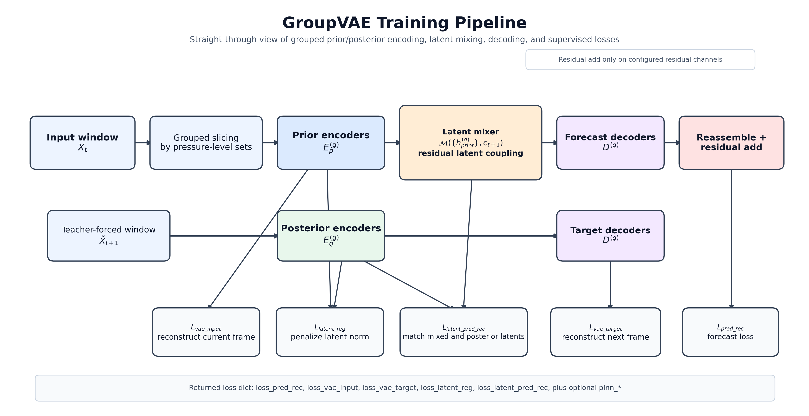

# GroupVAE

`GroupVAEPredictor` is implemented in [xmetai/models/group_vae.py](/Users/douzsh/Desktop/workspace/xionganyuan/cma/xmetai-core/xmetai/models/group_vae.py). Despite the name, the current training path is a grouped deterministic latent autoencoding pipeline with a prior branch, a posterior branch, and a latent mixer. It does not use a KL term or stochastic reparameterization in `forward()`.

## Model Architecture



The model splits the full atmospheric state into pressure-level groups, encodes each group independently, couples the group latents with a global latent mixer, and decodes back to the full field. Training supervises three reconstruction paths plus two latent-space regularizers.

## 1. Grouped State Representation

For a normalized input window with `in_frames = T_in`, the model takes:

$$ X_t = [x_{t-T_{in}+1}, \dots, x_t] \in \mathbb{R}^{B \times T_{in} \times C \times H \times W} $$

and a target rollout:

$$ Y_t = [x_{t+1}, \dots, x_{t+K}] \in \mathbb{R}^{B \times K \times C \times H \times W}. $$

`build_level_channel_map(...)` partitions the channel dimension into `G` groups:

$$ x_t = \{x_t^{(g)}\}_{g=1}^{G}, \qquad x_t^{(g)} \in \mathbb{R}^{C_g \times H \times W}, \qquad \sum_{g=1}^G C_g = C. $$

In the default setup:

- Group 0: `1000 hPa + surface-fast variables`
- Group 1: `925, 850, 700, 600, 500, 400 hPa`
- Group 2: `300, 250, 200, 150, 100, 50 hPa`
- Optional extra group: slow surface variables such as `sst` when `split_surface=True`

After grouped decoding, channels are concatenated and mapped back to the original full-field order by `group_reassemble_map`.

## 2. Encoders, Latent Mixer, and Decoders

For each group `g`, the model builds three modules:

- `vae_encoder_group[g]`: prior encoder `E_p^{(g)}`
- `posterior_encoder_group[g]`: posterior encoder `E_q^{(g)}`
- `decoder_group[g]`: decoder `D^{(g)}`

Each encoder/decoder is a `UTransformer`-based module. The cross-group coupling is handled by:

$$ \mathcal{M}: \{h^{(g)}\}_{g=1}^{G} \rightarrow \{\tilde{h}^{(g)}\}_{g=1}^{G} $$

implemented by `LatentMixerPredictor`.

At one rollout step, the code constructs:

$$ h_{t,\mathrm{prior}}^{(g)} = E_p^{(g)}(X_t^{(g)}) $$

$$ h_{t+1,\mathrm{post}}^{(g)} = E_q^{(g)}(\tilde{X}_{t+1}^{(g)}) $$

where

$$ \tilde{X}_{t+1} = [x_{t-T_{in}+2}, \dots, x_t, x_{t+1}] $$

is the teacher-forced window `new_target = cat(true_input, target)[:, -in_frames:]`.

The time-conditioning signal used by both the latent mixer and the decoders is the timestamp tuple built in code by `get_timestamp(...)`:

$$ c_t = (\mathrm{step}_t, \mathrm{hour}_t, \mathrm{doy}_t). $$

The prior latents are then coupled with the target timestamp condition:

$$ z_{t+1}^{(g)} = \mathcal{M}\big(\{h_{t,\mathrm{prior}}^{(g)}\}_{g=1}^G, c_{t+1}\big)_g. $$

## 3. Three Decoding Paths Used in Training

### 3.1 Input-window autoencoding branch

Each prior latent is decoded at the current timestamp:

$$ \Delta \hat{x}_{t,\mathrm{aein}}^{(g)} = D^{(g)}(h_{t,\mathrm{prior}}^{(g)}, c_t). $$

The grouped outputs are reassembled into a full-field prediction:

$$ \Delta \hat{x}_{t,\mathrm{aein}} = \mathrm{Reassemble}\Big(\{\Delta \hat{x}_{t,\mathrm{aein}}^{(g)}\}_{g=1}^G\Big). $$

If `vae_type` enables residual channels, `_apply_residual(...)` adds the decoded delta only on the configured indices using the previous frame as reference:

$$ \hat{x}_{t,\mathrm{aein}} = \mathcal{R}(\Delta \hat{x}_{t,\mathrm{aein}}, x_{t-1}). $$

This branch reconstructs the last frame in the input window, `x_t`.

### 3.2 Target-window autoencoding branch

Each posterior latent is decoded at the target timestamp:

$$ \Delta \hat{x}_{t+1,\mathrm{aetgt}}^{(g)} = D^{(g)}(h_{t+1,\mathrm{post}}^{(g)}, c_{t+1}). $$

After reassembly and optional residual restoration:

$$ \hat{x}_{t+1,\mathrm{aetgt}} = \mathcal{R}(\Delta \hat{x}_{t+1,\mathrm{aetgt}}, x_t). $$

which is supervised against the ground-truth next frame `x_{t+1}`.

### 3.3 Forecast branch

The coupled latent is decoded for each group:

$$ \Delta \hat{x}_{t+1,\mathrm{pred}}^{(g)} = D^{(g)}(z_{t+1}^{(g)}, c_{t+1}). $$

then reassembled and optionally converted to residual form:

$$ \hat{x}_{t+1,\mathrm{pred}} = \mathcal{R}\Big(\mathrm{Reassemble}(\{\Delta \hat{x}_{t+1,\mathrm{pred}}^{(g)}\}_{g=1}^G), x_t\Big). $$

This is the main autoregressive prediction branch. After loss computation, the model rolls the predicted frame into `input`, while the true target frame is rolled into `true_input` for the next teacher-forced posterior window.

## 4. Losses in `forward()`

The implementation accumulates five main losses:

### 4.1 Forecast reconstruction loss

Code key: `loss_pred_rec`

$$ \mathcal{L}_{\mathrm{pred}} = \sum_{k \in \mathcal{S}} w_k \cdot \rho\left(\hat{x}_{t+k,\mathrm{pred}}, x_{t+k}\right) $$

where `\rho` is `charbonnier_loss(...)`. If `channel_weights` is registered, the loss uses `self.channel_weights * self.weight`; otherwise it uses `self.weight`.

### 4.2 Input autoencoding loss

Code key: `loss_vae_input`

$$ \mathcal{L}_{\mathrm{aein}} = \sum_{k \in \mathcal{S}} w_k \cdot \rho\left(\hat{x}_{t+k-1,\mathrm{aein}}, x_{t+k-1}\right). $$

This branch regularizes the prior encoder-decoder path on the current input window.

### 4.3 Target autoencoding loss

Code key: `loss_vae_target`

$$ \mathcal{L}_{\mathrm{aetgt}} = \sum_{k \in \mathcal{S}} w_k \cdot \rho\left(\hat{x}_{t+k,\mathrm{aetgt}}, x_{t+k}\right). $$

This branch anchors the posterior encoder-decoder path on the teacher-forced target window.

### 4.4 Latent norm regularization

Code key: `loss_latent_reg`

$$ \mathcal{L}_{\mathrm{latentreg}} = \sum_{k \in \mathcal{S}} w_k \sum_{g=1}^{G} \left( |h_{k,\mathrm{prior}}^{(g)}|_2^2 + |h_{k,\mathrm{post}}^{(g)}|_2^2 \right). $$

In code this is:

$$ \mathrm{mean}(h_{\mathrm{prior}}^2) + \mathrm{mean}(h_{\mathrm{post}}^2). $$

This term stabilizes latent magnitude and replaces the role that a KL penalty would play in a stochastic VAE.

### 4.5 Latent prediction consistency loss

Code key: `loss_latent_pred_rec`

$$ \mathcal{L}_{\mathrm{latentmatch}} = \sum_{k \in \mathcal{S}} w_k \sum_{g=1}^{G} \rho\left(z_{t+k}^{(g)}, \mathrm{sg}\left(h_{t+k,\mathrm{post}}^{(g)}\right)\right). $$

where `sg(.)` is stop-gradient, matching the code path:

`charbonnier_loss(Z_coupled[g], h_posterior[g].detach())`

This directly trains the latent mixer to land on the posterior latent state of the next step.

## 5. Final Weighted Objective

The returned loss dictionary is:

$$ \mathcal{L}_{\mathrm{total}} = \lambda_{\mathrm{pred}} \mathcal{L}_{\mathrm{pred}} + \lambda_{\mathrm{aein}} \mathcal{L}_{\mathrm{aein}} + \lambda_{\mathrm{aetgt}} \mathcal{L}_{\mathrm{aetgt}} + \lambda_{\mathrm{latentreg}} \mathcal{L}_{\mathrm{latentreg}} + \lambda_{\mathrm{latentmatch}} \mathcal{L}_{\mathrm{latentmatch}} + \mathcal{L}_{\mathrm{PINN}}. $$

The scalar coefficients come from:

```python
loss_weight = (
    vae_input,
    vae_target,
    pred_rec,
    latent_reg,
    latent_pred,
)
```

with the current default:

```python
(0.2, 0.2, 1.0, 0.01, 0.3)
```

So the actual returned keys are:

- `loss_pred_rec = loss_weight[2] * loss_pred_rec`
- `loss_vae_input = loss_weight[0] * loss_vae_input`
- `loss_vae_target = loss_weight[1] * loss_vae_target`
- `loss_latent_reg = loss_weight[3] * loss_latent_reg`
- `loss_latent_pred_rec = loss_weight[4] * loss_latent_pred_rec`

If `pinn_enable=True`, `compute_pinn_losses(...)` adds extra entries such as `pinn_*`, averaged over `future_step`.

## 6. Rollout Weighting and Loss-Step Subsampling

At rollout index `k`, the base weight is:

$$ w_k \propto \alpha^k. $$

`build_loss_steps_and_weights(future_step, alpha, rollout_max)` then:

- keeps all rollout steps when `future_step <= rollout_max` or `rollout_max <= 0`
- otherwise keeps a deterministic subset of steps
- always includes the first and last step when `rollout_max > 1`
- normalizes the retained weights so `\sum_k w_k = 1`

This means long rollouts can be trained with sparse supervision while preserving a consistent weighting schedule.

## 7. Residual Reconstruction Mode

The helper `_apply_residual(pred, ref)` only adds residual corrections on `self.residual_vae_indices`.

Supported modes:

- `vae_type="absolute"`: no residual restoration, decoder outputs absolute values
- `vae_type="residual"`: all channels are residual channels
- `vae_type="index"`: only a selected subset is residual, either user-specified or derived from `RESIDUAL_VARS_24H` / `RESIDUAL_VARS_6H`

Formally, for channel index `c`:

$$ \hat{x}_c = \Delta \hat{x}_c + x^{\mathrm{ref}}_c \quad \text{for } c \in \mathcal{I}_{\mathrm{res}}, \qquad \hat{x}_c = \Delta \hat{x}_c \quad \text{for } c \notin \mathcal{I}_{\mathrm{res}}. $$

This lets slow-varying or anomaly-like variables be predicted in residual form without forcing the whole state vector into a residual parameterization.

## 8. Inference Path

`test_cascade(...)` uses only the prior path:

1. Slice current input window by group
2. Encode with `vae_encoder_group`
3. Mix latents with `latent_mixer`
4. Decode per group
5. Reassemble to the full field
6. Apply residual restoration if enabled
7. Roll the prediction back into the autoregressive input buffer

The posterior encoder and the two autoencoding losses are training-only components.

## 9. Practical Reading of the Design

The current `GroupVAEPredictor` can be read as a grouped latent world model with three complementary constraints:

- field-space supervision on the actual forecast
- field-space supervision on prior/posterior autoencoding quality
- latent-space supervision that aligns the mixed prior latent with the next-step posterior latent

That combination is the core training pipeline used by the implementation today.
