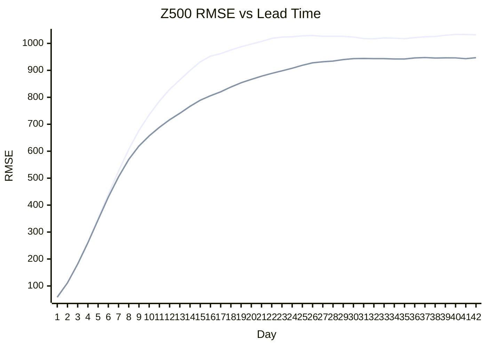

# GroupVAE

GroupVAE is a grouped latent state-space forecasting model for high-dimensional dynamical systems whose state variables can be organized into meaningful groups, such as pressure levels, variable families, spatial components, or other physical partitions. It learns a structured latent state, predicts the temporal evolution of that state, and decodes the evolved latent representation back to the original state space.

## 1. Model Architecture

The central design choice is to decompose the full state into meaningful groups before latent encoding. Instead of compressing all variables into a single representation, GroupVAE assigns separate encoders and decoders to different groups, then learns a shared latent state transition predictor to exchange information across groups and advance the system state. In weather forecasting, these groups can be pressure levels or variable families; in other state-space forecasting problems, they can be any domain-specific partition of the state vector.

For an input history and target rollout,

$$
X_t \in \mathbb{R}^{B \times T_{\mathrm{in}} \times C \times H \times W},
\qquad
Y_t \in \mathbb{R}^{B \times K \times C \times H \times W}.
$$

The channel dimension is partitioned into groups:

$$
x_t = \{x_t^{(g)}\}_{g=1}^{G},
\qquad
\sum_{g=1}^{G} C_g = C.
$$

In the level-wise S2S setting, the groups are organized as follows.

| Group | Physical scope |
| --- | --- |
| 0 | Near-surface and 1000 hPa variables |
| 1 | Lower-to-middle pressure levels from 925 hPa to 400 hPa |
| 2 | Upper pressure levels from 300 hPa to 50 hPa |
| Optional | Slow surface variables, such as sea-surface temperature, when surface splitting is enabled |

Each group has a prior encoder, a posterior encoder, and a group-specific decoder shared by the reconstruction and forecasting branches. The prior encoder maps the current autoregressive input window into a group latent state. The posterior encoder maps a teacher-forced window, which includes the true next frame, into a target latent state. The decoder maps each latent state back to field space.

The latent state transition predictor is the module that explicitly couples groups. It receives all prior latent states and a timestamp condition, then predicts the next latent state for every group:

$$
\hat{h}_{t+1}^{(g)}
= \Phi_g(
h_{t,\mathrm{prior}}^{(1)}, \ldots, h_{t,\mathrm{prior}}^{(G)}, c_{t+1}
).
$$

Here, $\Phi_g$ denotes the group-specific output of the learned state transition operator, and the timestamp condition contains forecast step, hour, and day-of-year information. After decoding, the group outputs are reassembled into the original full-field channel order. At inference time, only the autonomous prior path is used: encode the current input, predict the next latent state, decode, reassemble, and roll the prediction into the next input window.

## 2. Training Stages

Training is organized as a staged curriculum. The goal is to first learn a stable latent state space, then align the autonomous state transition with that space, and finally train longer autoregressive rollouts without damaging selected pretrained group dynamics.

### 2.1 Pretrain

The pretraining stage focuses on posterior state-space learning. The model reconstructs both clean and augmented inputs, while a contrastive latent objective encourages stable representations under channel masking and temporal mixing.

This stage optimizes three objectives:

| Objective | Purpose |
| --- | --- |
| Reconstruction | Make the posterior encoder and decoder recover state fields accurately |
| Latent metric learning | Encourage augmented views of the same state to remain close in latent space |
| Latent regularization | Control latent magnitude and reduce collapse risk |

Conceptually, pretraining gives the posterior branch a well-conditioned target manifold. Later stages can then train the prior encoder and state transition predictor to approach this manifold without direct access to future observations.

The pretraining objective can be summarized as

$$
\begin{aligned}
\mathcal{L}_{\mathrm{pre}}
&= \rho(\hat{x}_{t}, x_t) + \lambda_{\mathrm{aug}}\rho(\hat{x}_{t,\mathrm{aug}}, x_t) \\
&\quad + \lambda_{\mathrm{metric}}
\mathcal{L}_{\mathrm{NCE}}(h_{\mathrm{clean}}, h_{\mathrm{aug}}) \\
&\quad + \lambda_{\mathrm{reg}}\frac{1}{G}\sum_{g=1}^{G}
\big[\mathrm{mean}((h_{\mathrm{clean}}^{(g)})^2) + \mathrm{mean}((h_{\mathrm{aug}}^{(g)})^2)\big].
\end{aligned}
$$

Here, $\rho$ is the robust reconstruction loss. This objective reconstructs the latest frame in the input window and regularizes both clean and augmented posterior latents.

### 2.2 One-Step

After pretraining, the posterior encoder can be frozen. This turns it into a fixed teacher that defines the target latent state for the next observed frame. The trainable prior encoder and state transition predictor must learn to reach that teacher latent state from the current input window.

The stage uses three complementary field-space branches:

| Branch | Supervision target | Role |
| --- | --- | --- |
| State-space forecasting | Next target frame | Trains the autonomous prediction path |
| Input autoencoding | Last input frame | Keeps the prior encoder-decoder path reconstructive |
| Target autoencoding | True next frame | Keeps the frozen posterior target interpretable in field space |

The posterior teacher window is formed by shifting the input window forward and inserting the true next frame:

$$
\tilde{X}_{t+1}
= [x_{t-T_{\mathrm{in}}+2}, \ldots, x_t, x_{t+1}].
$$

The key latent-space objective is state prediction consistency:

$$
\begin{aligned}
\mathcal{L}_{\mathrm{state}}
&= \sum_{k \in \mathcal{S}} w_k
\sum_{g=1}^{G}
\rho(
\hat{h}_{t+k}^{(g)},
\mathrm{sg}(h_{t+k,\mathrm{post}}^{(g)})
).
\end{aligned}
$$

The stop-gradient operator makes the posterior branch a fixed target. This prevents the teacher latent space from moving to accommodate weak prior predictions, and instead forces the prior encoder and state transition predictor to learn meaningful one-step dynamics.

### 2.3 Rollout

The rollout stage extends training from one-step prediction to longer autoregressive forecasts. Encoders for selected groups can be frozen in the prior branch, the posterior branch, or both, which preserves their pretrained dynamics and reduces GPU memory use. In the current level-wise S2S setting, the frozen groups correspond to the middle and upper atmosphere, where preserving pretrained latent dynamics is especially important for stable long-horizon forecasts.

Only the remaining trainable components are adapted during rollout. This gives the model enough flexibility to improve autoregressive behavior while reducing the risk of overwriting the pretrained vertical latent structure.

Rollout training also uses scheduled teacher-forcing windows. The current level-wise S2S rollout starts supervised expansion at step 9 and ends at step 20, with the forecast dataset length matched to the 20-step horizon. Long rollouts may use sparse loss-step supervision: at most 10 loss steps are retained, the first and last supervised steps are preserved when applicable, and step weights are normalized.

## 3. S2S Config Settings & Final Result

This section reports one concrete [S2S forecasting setting](../../configs/s2s_group_vae.py) and result. It should be read as an experiment configuration, not as a limitation of the GroupVAE architecture.

The S2S configuration uses a level-wise GroupVAE with a 120 by 240 spatial grid, two input frames, one output frame per model step, 24-hour temporal frequency, and a maximum supervised rollout loss subset of 10 steps. When loaded from a pretrained checkpoint, the rollout curriculum trains lead steps 9 through 20, halves the base training iteration budget, and freezes the middle and upper atmosphere encoder groups. The experiment uses three level groups: near-surface, lower-to-middle atmosphere, and upper atmosphere. Residual prediction is applied selectively to slow or anomaly-like variables, such as sea-surface temperature and two-meter temperature.

The main weighted training objective combines five terms:

| Term | Relative role |
| --- | --- |
| Forecast reconstruction | Main prediction accuracy objective |
| Prior autoencoding | Regularizes the autonomous input representation |
| Posterior autoencoding | Maintains the teacher latent representation in field space |
| Latent regularization | Stabilizes latent magnitude |
| State prediction consistency | Aligns predicted prior latents with posterior teacher latents |

In the S2S setting, forecast reconstruction receives the largest direct field-space weight, while state prediction consistency is also strongly weighted. The autoencoding terms are kept as auxiliary constraints, and latent magnitude regularization is intentionally small.

### Final Result Snapshot

Increasing rollout training improves long-lead Z500 RMSE, especially after the second forecast week.

Selected channel RMSE values with different lead times are listed below.

|   Times |    z500 |   u200 |   u850 |     msl |   t2m |   sst |    ttr |    tp |
|--------:|--------:|-------:|-------:|--------:|------:|------:|-------:|------:|
|      24 |  57.538 |  1.629 |  1.094 |  91.880 | 0.680 | 0.162 | 11.173 | 0.212 |
|      48 | 109.993 |  2.359 |  1.549 | 135.455 | 0.854 | 0.211 | 13.464 | 0.231 |
|      72 | 178.724 |  3.184 |  2.055 | 195.187 | 1.030 | 0.246 | 15.083 | 0.244 |
|      96 | 256.245 |  4.097 |  2.581 | 264.271 | 1.221 | 0.278 | 16.566 | 0.257 |
|     120 | 340.240 |  5.077 |  3.091 | 337.898 | 1.425 | 0.310 | 18.115 | 0.266 |
|     144 | 422.646 |  6.067 |  3.551 | 408.219 | 1.617 | 0.336 | 19.510 | 0.275 |
|     168 | 497.427 |  6.997 |  3.931 | 470.255 | 1.812 | 0.371 | 20.712 | 0.286 |
|     192 | 562.355 |  7.838 |  4.251 | 520.317 | 1.967 | 0.415 | 21.758 | 0.290 |
|     216 | 614.271 |  8.544 |  4.493 | 559.560 | 2.103 | 0.452 | 22.723 | 0.296 |
|     240 | 652.220 |  9.109 |  4.678 | 593.183 | 2.212 | 0.468 | 23.457 | 0.300 |
|     264 | 684.932 |  9.582 |  4.842 | 622.287 | 2.301 | 0.484 | 24.152 | 0.303 |
|     288 | 713.501 | 10.039 |  4.980 | 644.181 | 2.396 | 0.505 | 24.942 | 0.304 |
|     312 | 737.696 | 10.382 |  5.116 | 666.099 | 2.487 | 0.520 | 25.555 | 0.305 |
|     336 | 763.578 | 10.732 |  5.240 | 691.166 | 2.562 | 0.535 | 26.072 | 0.309 |
|     360 | 786.544 | 11.062 |  5.324 | 709.735 | 2.648 | 0.555 | 26.474 | 0.309 |
|     384 | 802.840 | 11.389 |  5.394 | 720.907 | 2.724 | 0.570 | 26.896 | 0.311 |
|     408 | 816.185 | 11.669 |  5.480 | 735.641 | 2.792 | 0.584 | 27.192 | 0.312 |
|     432 | 832.322 | 11.869 |  5.561 | 752.330 | 2.851 | 0.598 | 27.528 | 0.314 |
|     456 | 846.863 | 12.103 |  5.631 | 764.572 | 2.908 | 0.617 | 27.901 | 0.315 |
|     480 | 858.487 | 12.294 |  5.693 | 775.819 | 2.962 | 0.630 | 28.048 | 0.314 |
|     504 | 869.967 | 12.468 |  5.729 | 786.860 | 3.011 | 0.642 | 28.218 | 0.317 |
|     528 | 879.513 | 12.611 |  5.764 | 795.829 | 3.060 | 0.660 | 28.424 | 0.316 |
|     552 | 886.317 | 12.774 |  5.806 | 799.956 | 3.097 | 0.671 | 28.529 | 0.316 |
|     576 | 892.578 | 12.898 |  5.847 | 804.941 | 3.127 | 0.683 | 28.561 | 0.317 |
|     600 | 900.408 | 12.926 |  5.872 | 809.106 | 3.155 | 0.694 | 28.596 | 0.317 |
|     624 | 907.456 | 12.997 |  5.884 | 810.781 | 3.182 | 0.709 | 28.715 | 0.317 |
|     648 | 909.528 | 13.077 |  5.897 | 810.470 | 3.204 | 0.719 | 28.680 | 0.316 |
|     672 | 910.002 | 13.100 |  5.894 | 810.626 | 3.212 | 0.728 | 28.728 | 0.319 |
|     696 | 913.444 | 13.093 |  5.900 | 811.933 | 3.217 | 0.742 | 28.742 | 0.318 |
|     720 | 913.881 | 13.130 |  5.883 | 808.959 | 3.217 | 0.751 | 28.706 | 0.318 |
|     744 | 911.593 | 13.168 |  5.874 | 805.974 | 3.221 | 0.759 | 28.742 | 0.318 |
|     768 | 909.465 | 13.111 |  5.865 | 801.431 | 3.222 | 0.767 | 28.746 | 0.318 |
|     792 | 907.647 | 13.085 |  5.850 | 796.621 | 3.215 | 0.780 | 28.682 | 0.318 |
|     816 | 903.746 | 13.077 |  5.830 | 792.806 | 3.201 | 0.788 | 28.601 | 0.317 |
|     840 | 903.068 | 13.046 |  5.810 | 792.065 | 3.188 | 0.795 | 28.582 | 0.318 |
|     864 | 904.578 | 13.002 |  5.805 | 792.020 | 3.181 | 0.808 | 28.601 | 0.318 |
|     888 | 902.490 | 12.969 |  5.782 | 787.618 | 3.176 | 0.815 | 28.504 | 0.317 |
|     912 | 898.623 | 12.945 |  5.785 | 785.832 | 3.174 | 0.821 | 28.464 | 0.318 |
|     936 | 897.690 | 12.909 |  5.784 | 784.989 | 3.168 | 0.828 | 28.465 | 0.317 |
|     960 | 897.891 | 12.901 |  5.773 | 783.304 | 3.157 | 0.840 | 28.497 | 0.317 |
|     984 | 896.191 | 12.914 |  5.762 | 781.614 | 3.149 | 0.847 | 28.501 | 0.317 |
|    1008 | 897.807 | 12.904 |  5.773 | 784.254 | 3.150 | 0.853 | 28.489 | 0.318 |

The final checkpoint referenced by the s2s forecasting experiment is available from [Quark Cloud](https://pan.quark.cn/s/d8931703aee5?pwd=2pEV).
