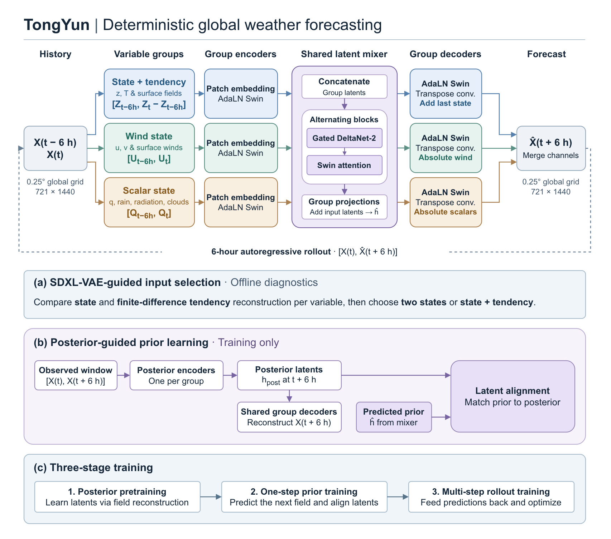

# TongYun

TongYun is a grouped latent state-space model for weather and climate prediction.
It combines variable-specific state or tendency representations with a shared
dynamics predictor. SDXL-VAE diagnostics guide the choice of input
representation. During training, the posterior supplies future latent targets
for the prior. A three-stage curriculum trains the posterior first, then the
single-step prior, and finally the autoregressive rollout.

The public class is `xmetai.models.tongyun.TongYun`, registered as
`MODELS.get("TongYun")`. The two configurations below are deterministic
forecasting examples.

- [Short- and medium-range deterministic forecasting](../../configs/iwc_tongyun_det_v1_0.py), shown in the figure below with a 6-hour forecast step.
- [Subseasonal-to-seasonal (S2S) deterministic forecasting](../../configs/s2s_tongyun.py).

Ensemble forecast models build on this architecture by introducing
perturbations to generate multiple forecast members.

## Variable groups, shared dynamics

Each group has its own encoders and decoder. The shared latent mixer
concatenates the prior encoder outputs, couples them through alternating Gated
DeltaNet-2 and Swin blocks, then projects the result back to each group and adds
its input latent. Group decoders reconstruct the next fields, which are merged
in their original channel order and fed back into the next input window.
The mixer architecture is selected by `vt_layer_type`, and `freq` sets the
forecast cadence.

## (a) SDXL-VAE-guided input selection

The grouping is informed by offline, per-variable diagnostics using SDXL-VAE.
For each weather variable, the diagnostics compare how well the autoencoder represents
the state field and its temporal tendency. This identifies which variables are
better modeled through state reconstruction and which benefit from learning
changes relative to a reference state. TongYun uses those findings to choose
the representation and reconstruction mode for each group, rather than imposing
one representation on every variable.

| Group | Fields | Input representation | Output reconstruction |
| --- | --- | --- | --- |
| State-tendency (`residual_state`, **Z** in the figure) | Geopotential and temperature across pressure levels, plus selected surface fields | Previous state and state difference | Residual |
| Wind state (`abs_wind`, **U**) | Pressure-level and near-surface wind | Two state frames | Absolute |
| Scalar state (`abs_scalar`, **Q**) | Specific humidity, precipitation, radiation and cloud fields | Two state frames | Absolute |

For a two-frame input, the state-tendency group encodes
`[x_previous, x_current - x_previous]`; the other groups encode
`[x_previous, x_current]`. Here, tendency means the finite difference between
frames at the configured cadence. Forecast residuals are added to the last
input frame, while absolute outputs are used directly.

The default groups are defined by `GROUP_VAR_MAP` and `GROUP_RECON_MODES` in
[tongyun.py](../../xmetai/models/tongyun/tongyun.py). The forecast uses the
resulting group definitions.

## (b) Posterior-guided prior learning

During training, each group’s posterior encoder receives a window containing
the current frame and the true next frame. The shared group decoders use the
posterior latents to reconstruct the next field. The same latents serve as
targets for the prior forecasting path, which predicts them from the historical
input window. This gives the prior supervision in both latent and field space.

## (c) Three-stage training

1. **Posterior pretraining.** Train the group posterior encoders and shared
   decoders to reconstruct fields and learn group representations.
2. **One-step prior training.** Train the prior forecasting path to predict the
   next field and align the predicted latents with the posterior targets.
3. **Multi-step rollout training.** Feed predicted fields back into subsequent
   input windows and optimize over the resulting autoregressive trajectory.

## Modular groups and multi-sphere extension

Separating group-specific representation learning from shared dynamics makes
TongYun flexible to extend. Groups can represent variable families within the
atmosphere or fields from different Earth-system spheres, such as the ocean,
land and sea ice. Each group can use a suitable channel layout and latent
capacity without requiring all fields to share one encoder-decoder.

This modular structure supports training group representations separately,
then bringing them together through the shared latent predictor. Pretrained
group modules can be retained or frozen while the coupling and selected groups
are trained jointly. Adding a new sphere therefore follows the same pattern:
define its variables and representation, train its group modules, and integrate
its latent state into the shared dynamics model.

Custom `group_var_map` and `group_recon_modes` dictionaries define the grouping
and whole-group absolute/residual modes. Each input channel must belong to
exactly one group. The common latent interface provides a consistent coupling
point while allowing the group representations to be developed independently.

## Inference

Inference uses only the prior path and requires no future observations. At each
step, TongYun encodes the current input window, predicts coupled future latent
states, decodes and merges the group outputs, and updates the input window for
the next forecast step. The posterior teacher and SDXL-VAE diagnostics are used
for training and model design, respectively.
