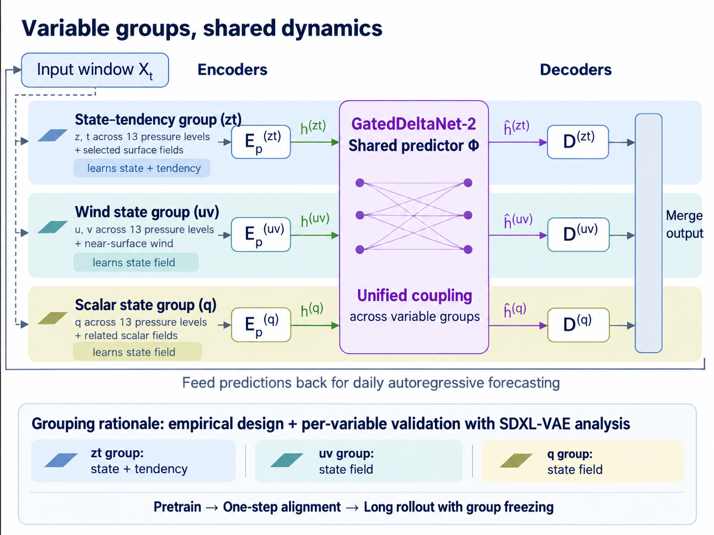

# TongYun

TongYun is a grouped latent state-space model for weather and climate prediction.
It combines variable-specific state or tendency representations with a shared
dynamics predictor. Its main features are SDXL-VAE-guided grouping, a modular
architecture that can extend across Earth-system spheres, and a three-stage
training curriculum that separates representation learning from forecasting.

The public class is `xmetai.models.tongyun.TongYun`, registered as
`MODELS.get("TongYun")`. The S2S recipe is
[s2s_tongyun.py](../../configs/s2s_tongyun.py).

## Variable groups, shared dynamics

Each group has its own encoders and decoder. A shared latent dynamics predictor
couples all groups, predicts their future latent states, and passes those states
to the corresponding decoders. The decoded fields are merged in the original
channel order and fed back into the next autoregressive input window.

The figure illustrates a GatedDeltaNet-2 dynamics predictor and daily feedback.
The predictor is selected through `vt_layer_type`, while `freq` controls the
forecast cadence; these choices do not change the grouped architecture.

## SDXL-VAE-guided state and tendency grouping

The grouping is informed by per-variable diagnostics using SDXL-VAE. For each
weather variable, the diagnostics compare how well the autoencoder represents
the state field and its temporal tendency. This identifies which variables are
better modeled through state reconstruction and which benefit from learning
changes relative to a reference state. TongYun uses those findings to choose
the representation and reconstruction mode for each group, rather than imposing
one representation on every variable.

| Group | Fields | Input representation | Output reconstruction |
| --- | --- | --- | --- |
| State-tendency (`residual_state`, zt in the figure) | Geopotential and temperature across pressure levels, plus selected surface thermodynamic fields | Previous state and state difference | Residual |
| Wind state (`abs_wind`, uv) | Pressure-level and near-surface wind | Two state frames | Absolute |
| Scalar state (`abs_scalar`, q) | Specific humidity, precipitation, radiation and cloud fields | Two state frames | Absolute |

For a two-frame input, the state-tendency group encodes
`[x_previous, x_current - x_previous]`; the other groups encode
`[x_previous, x_current]`. Here, tendency means the finite difference between
frames at the configured cadence. Forecast residuals are added to the last
input frame, while absolute outputs are used directly.

The default groups are defined by `GROUP_VAR_MAP` and `GROUP_RECON_MODES` in
[tongyun.py](../../xmetai/models/tongyun/tongyun.py). SDXL-VAE provides the
representation diagnostics; it is not a required component of forecast inference.

## Modular groups and multi-sphere extension

Separating group-specific representation learning from shared dynamics makes
TongYun flexible to extend. Groups can represent variable families within the
atmosphere or fields from different Earth-system spheres, such as the ocean,
land and sea ice. Each group can use a suitable channel layout and latent
capacity without requiring all fields to share one encoder-decoder.

This modular structure supports training group representations separately,
then bringing them together through the shared latent predictor. Pretrained
group modules can be retained or frozen while the coupling and selected groups
are trained jointly. Adding a new sphere therefore follows the same pattern:
define its variables and representation, train its group modules, and integrate
its latent state into the shared dynamics model.

Custom `group_var_map` and `group_recon_modes` dictionaries define the grouping
and whole-group absolute/residual modes. Each input channel must belong to
exactly one group. The common latent interface provides a consistent coupling
point while allowing the group representations to be developed independently.

## Three-stage training

TongYun divides learning into VAE representation training, single-step
forecasting and autoregressive rollout training. This curriculum reduces the
optimization burden of learning field representations and long-range dynamics
at the same time, helping the model converge more reliably.

### 1. VAE representation training

Train the group encoders and decoders to reconstruct their fields and establish
a useful latent state space. Reconstruction of clean and augmented views,
latent metric learning and latent regularization support stable group
representations. These modules provide the starting point for forecasting
instead of requiring the dynamics predictor to learn against an unstructured
latent space from the outset.

### 2. Single-step forecasting and latent alignment

Train the prior forecasting path to predict the next field and its latent
state. During training, the posterior encoder receives a teacher window
containing the true next frame and supplies the future latent target. The
shared dynamics predictor learns to reach that target from the current grouped
latent states; the posterior teacher can be frozen to keep the target space
stable.

This provides supervision in both field space and latent space. The model
learns where the future state should lie in the learned representation, rather
than relying only on error propagated back through the decoded forecast.
That more direct learning signal improves learning efficiency and supports
stable optimization of the temporal dynamics.

### 3. Autoregressive rollout training

Extend the single-step predictor to longer trajectories by feeding predictions
back into subsequent input windows. The model learns to handle its own forecast
states and reduce accumulated rollout error. Selected group encoders can be
frozen through `train.freeze` to preserve pretrained representations while the
shared dynamics and remaining trainable components adapt to longer horizons.

Together, the three stages establish the latent representation first, align
single-step dynamics with future latent states next, and finally train the
model for sustained autoregressive forecasting.

## Inference

Inference uses only the prior path and requires no future observations. At each
step, TongYun encodes the current input window, predicts coupled future latent
states, decodes and merges the group outputs, and updates the input window for
the next forecast step. The posterior teacher and SDXL-VAE diagnostics are used
for training and model design, respectively.
